# KIẾN TRÚC VÀ LƯỢC ĐỒ CƠ SỞ DỮ LIỆU CLOUD FIRESTORE
**Dự án**: E-Commerce Market Place (Nhóm 13)
**Hệ quản trị**: Google Cloud Firestore (NoSQL Document Store)
**Cơ chế xác thực**: Firebase Authentication (Email/Password & Anonymous Guest)

---

## 1. TỔNG QUAN CÁC COLLECTIONS CHÍNH

Hệ thống lưu trữ phân tầng kết hợp giữa **Root Collections** (cho dữ liệu công khai hoặc liên cơ quan) và **Subcollections** lồng dưới `users/{uid}` (cho dữ liệu sở hữu cá nhân).

```mermaid
graph TD
  categories["categories/{id}"]
  brands["brands/{id}"]
  products["products/{id}"]
  reviews["products/{id}/reviews/{reviewId}"]
  vouchers["vouchers/{code}"]
  shippingMethods["shippingMethods/{id}"]
  faqGroups["faqGroups/{id}"]
  faqs["faqs/{id}"]
  popularSearches["popularSearches/{id}"]
  users["users/{uid}"]
  addresses["users/{uid}/addresses/{id}"]
  paymentMethods["users/{uid}/paymentMethods/{id}"]
  favourites["users/{uid}/favourites/{productId}"]
  cart["users/{uid}/cart/{itemKey}"]
  notifications["users/{uid}/notifications/{id}"]
  searchHistory["users/{uid}/searchHistory/{id}"]
  settings["users/{uid}/settings/app"]
  orders["orders/{id}"]
  tickets["tickets/{id}"]

  products --> reviews
  users --> addresses
  users --> paymentMethods
  users --> favourites
  users --> cart
  users --> notifications
  users --> searchHistory
  users --> settings
```

---

## 2. CHI TIẾT CẤU TRÚC DOCUMENT TỪNG BẢNG

### 2.1. Root Collection: `categories/{id}`
- **id**: string (ví dụ: `audio`, `phones`, `laptops`, `accessories`, `watches`, `tablets`)
- **name**: string (Tên hiển thị tiếng Việt, ví dụ: "Âm thanh")
- **icon**: string (Tên icon Ionicons/Material, ví dụ: "headphones", "smartphone")
- **productCount**: number (Số lượng mặt hàng)
- **createdAt**: timestamp (ISO string hoặc Firestore Timestamp)

### 2.2. Root Collection: `brands/{id}`
- **id**: string (ví dụ: `aurasound`, `voxtech`, `hyper`, `luna`)
- **name**: string (Tên thương hiệu, ví dụ: "AuraSound")
- **logo**: string (URL hình ảnh logo)
- **productCount**: number

### 2.3. Root Collection: `products/{id}`
- **id**: string (ví dụ: `prod_aurabeats_pro`)
- **name**: string (Tên sản phẩm)
- **brandId**: string (Liên kết `brands/{id}`)
- **brandName**: string
- **categoryId**: string (Liên kết `categories/{id}`)
- **categoryName**: string
- **price**: number (Giá bán hiện tại, tính theo VNĐ hoặc đơn vị tiền tệ)
- **originalPrice**: number (Giá gốc trước khi giảm)
- **discountPercent**: number (Tính từ (originalPrice - price) / originalPrice)
- **rating**: number (Điểm đánh giá trung bình từ 1.0 đến 5.0)
- **reviewCount**: number (Tổng số lượt đánh giá)
- **soldCount**: number (Số lượng đã bán)
- **stock**: number (Số lượng hàng tồn kho còn lại - trừ nguyên tử qua Transaction)
- **inStock**: boolean (`stock > 0`)
- **featured**: boolean (Sản phẩm nổi bật hiển thị trang chủ)
- **isNew**: boolean
- **description**: string (Mô tả chi tiết sản phẩm)
- **images**: string[] (Danh sách link hình ảnh)
- **colors**: `{ id: string, name: string, hex: string }[]` (Biến thể màu sắc)
- **sizes**: string[] (Biến thể kích cỡ / dung lượng: S, M, L hoặc 128GB, 256GB)
- **tags**: string[] (Từ khóa tìm kiếm: ["tainghe", "bluetooth", "chongon"])
- **createdAt**: string | Timestamp

#### Subcollection: `products/{id}/reviews/{reviewId}`
- **id**: string
- **userId**: string
- **userName**: string
- **userAvatar**: string
- **rating**: number (1-5)
- **comment**: string
- **createdAt**: string | Timestamp

### 2.4. Root Collection: `vouchers/{code}` (Đồng bộ chuẩn hoá từ `promos`)
- **code**: string (Khóa chính ID, ví dụ: `DISCOUNT10`, `FREESHIP`, `WELCOME20`, `SUMMERSALE`)
- **title**: string (Tiêu đề khuyến mãi)
- **description**: string (Mô tả điều kiện)
- **discountType**: `'percent' | 'fixed'`
- **discountValue**: number (Giá trị giảm, ví dụ: 10% hoặc 50.000đ)
- **maxDiscount**: number | null (Mức giảm tối đa với voucher %)
- **minOrderValue**: number (Giá trị đơn hàng tối thiểu để áp dụng)
- **freeShipping**: boolean (Miễn phí vận chuyển)
- **usageLimit**: number (Số lần sử dụng tối đa)
- **usedCount**: number (Số lần đã được áp dụng trong đơn thành công)
- **startDate**: string
- **endDate**: string (Hạn sử dụng)
- **isActive**: boolean

### 2.5. Root Collection: `shippingMethods/{id}`
- **id**: string (ví dụ: `ship_standard`, `ship_express`, `ship_same_day`)
- **name**: string ("Giao hàng tiêu chuẩn", "Giao hàng hỏa tốc")
- **description**: string ("Nhận hàng trong 2-3 ngày làm việc")
- **price**: number (30.000đ, 60.000đ...)
- **estimatedDays**: string ("2-3 ngày")
- **freeOver**: number | null (Miễn phí ship nếu đơn hàng trên mức này, ví dụ: 500.000đ)

### 2.6. Root Collection: `users/{uid}` (Hồ sơ người dùng)
> **BẢO MẬT TUYỆT ĐỐI**: Không lưu mật khẩu ở Firestore! Xác thực do Firebase Auth quản lý.
- **uid**: string (Trùng với `auth.currentUser.uid`)
- **email**: string
- **fullName**: string
- **phone**: string (Số điện thoại chuẩn hóa)
- **avatarUrl**: string | null
- **isGuest**: boolean
- **createdAt**: string | Timestamp
- **updatedAt**: string | Timestamp

#### Subcollection: `users/{uid}/addresses/{id}`
- **id**: string
- **label**: string ("Nhà riêng", "Văn phòng")
- **receiverName**: string (Họ tên người nhận)
- **receiverPhone**: string (SĐT liên hệ giao hàng)
- **province**: string
- **district**: string
- **ward**: string
- **streetAddress**: string (Số nhà, tên đường chi tiết)
- **isDefault**: boolean (Chỉ duy nhất 1 địa chỉ có `isDefault = true`)

#### Subcollection: `users/{uid}/paymentMethods/{id}`
> **BẢO MẬT**: Không bao giờ lưu số thẻ đầy đủ 16 số hay mã bảo mật CVV!
- **id**: string
- **brand**: string ("visa", "mastercard", "jcb", "cod")
- **cardHolder**: string (Tên in trên thẻ)
- **last4**: string (4 số cuối của thẻ)
- **expiryMonth**: number
- **expiryYear**: number
- **isDefault**: boolean (Chỉ duy nhất 1 thẻ mặc định)

#### Subcollection: `users/{uid}/favourites/{productId}`
- **productId**: string
- **addedAt**: string | Timestamp

#### Subcollection: `users/{uid}/cart/{itemKey}`
- **itemKey**: string (Khóa ghép: `productId-color-size`)
- **productId**: string
- **name**: string
- **price**: number
- **image**: string
- **selectedColor**: string
- **selectedSize**: string
- **quantity**: number
- **selected**: boolean (Đang được chọn để thanh toán)
- **updatedAt**: string | Timestamp

#### Subcollection: `users/{uid}/notifications/{id}`
- **id**: string
- **title**: string
- **message**: string
- **type**: `'order' | 'promo' | 'system'`
- **read**: boolean
- **createdAt**: string | Timestamp

#### Subcollection: `users/{uid}/searchHistory/{id}`
- **id**: string
- **keyword**: string
- **searchedAt**: string | Timestamp

#### Document Đơn: `users/{uid}/settings/app`
- **notificationsEnabled**: boolean
- **darkMode**: boolean
- **language**: `'vi' | 'en'`
- **currency**: `'VND' | 'USD'`

### 2.7. Root Collection: `orders/{id}`
- **id**: string (ví dụ: `ORD-1718000000-XYZ`)
- **userId**: string
- **userEmail**: string
- **items**: `{ productId, name, price, quantity, color, size, image }[]`
- **subtotal**: number (Tổng tiền hàng)
- **shippingFee**: number (Phí vận chuyển)
- **discountAmount**: number (Số tiền được giảm)
- **voucherCode**: string | null
- **taxAmount**: number (Thuế 8%)
- **total**: number (Tổng thanh toán cuối cùng = subtotal - discountAmount + shippingFee + taxAmount)
- **status**: `'pending' | 'processing' | 'shipped' | 'delivered' | 'cancelled'`
- **cancelReason**: string | null (Bắt buộc khi status = cancelled)
- **cancelledAt**: string | null
- **addressSnapshot**: `{ receiverName, receiverPhone, fullAddress }`
- **paymentSnapshot**: `{ method: 'cod' | 'card', last4?: string, brand?: string }`
- **timeline**: `{ status: string, title: string, description: string, timestamp: string }[]`
- **createdAt**: string | Timestamp
- **updatedAt**: string | Timestamp

### 2.8. Root Collection: `support` (FAQs & Tickets)
- `faqGroups/{id}`: `{ id, title, icon, order }`
- `faqs/{id}`: `{ id, groupId, question, answer, order }`
- `tickets/{id}`: `{ id, userId, userEmail, subject, message, status: 'open' | 'resolved', createdAt }`
- `popularSearches/{id}`: `{ id, keyword, count }`

---

## 3. NGUYÊN TẮC TRANSACTION KHI ĐẶT HÀNG & HUỶ ĐƠN

1. **Đặt hàng (`createOrder`)**:
   - Sử dụng `db.runTransaction()`.
   - Đọc từng sản phẩm trong mảng `items`: xác minh `stock >= quantity`.
   - Lấy giá trực tiếp từ document sản phẩm trong database, không chấp nhận giá từ client.
   - Trừ `stock` tương ứng, tăng `soldCount`.
   - Nếu có `voucherCode`: xác minh điều kiện hạn, minOrderValue và usageLimit; tăng `usedCount`.
   - Ghi document `orders/{orderId}` với status ban đầu là `pending`.
   - Tạo thông báo `users/{uid}/notifications`.
   - Xóa các item đã mua khỏi giỏ hàng `users/{uid}/cart`.

2. **Huỷ đơn (`cancelOrder`)**:
   - Chỉ cho phép huỷ khi trạng thái đang là `pending` hoặc `processing`.
   - Bắt buộc có lý do huỷ `reason`.
   - Sử dụng transaction hoàn lại `stock` cho từng sản phẩm và giảm `soldCount`.
   - Giảm `usedCount` của voucher nếu đơn có dùng mã.
   - Thêm bước 'Đã huỷ' vào mảng `timeline`.
   - Tạo thông báo huỷ đơn.
